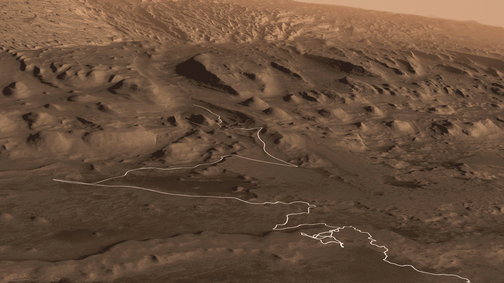
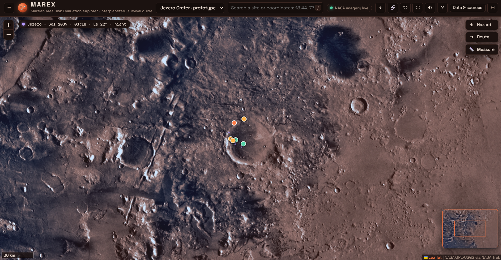

<div align="center">

# 🔴 MAREX
### Martian Area Risk Evaluation eXplorer



<sub>Banner: NASA/JPL-Caltech (PIA23179)</sub>

**An interactive web map for exploring Mars terrain and evaluating surface risk, right in your browser.**


[Features](#features) · [Screenshots](#screenshots) · [Getting Started](#getting-started) · [Project Structure](#project-structure) · [AI Disclosure](#ai-disclosure)

</div>

---

## About

**MAREX** is a lightweight, framework-free web application for exploring the surface of Mars on an interactive map. It is built on [Leaflet](https://leafletjs.com/) and powered by [NASA Solar System Treks](https://trek.nasa.gov/) map tiles, combining terrain layers, sites of interest, hazard overlays and measurement tools in one clean interface.

The goal is simple: make Martian terrain data **easy to explore, easy to understand, and useful for reasoning about where it may be safe to land or travel**.

> 💡 **No build step, no bundler, no dependencies to install.** Just static files served by any web server.

---

## Features

| | Feature | Description |
|---|---------|-------------|
| 🗺️ | **Interactive Mars map** | Smooth pan and zoom over real NASA Trek Mars tiles |
| 🧱 | **Multiple base layers** | Switch between terrain and surface base layers, plus toggleable overlays |
| ⛰️ | **Terrain analysis** | Slope and elevation evaluation built into the map |
| 🌦️ | **Weather layer** | Mars weather context to support risk assessment |
| 📍 | **Sites of interest** | Browse landing sites and notable locations on the planet |
| ⚠️ | **Hazard overlays** | Visualize risk areas to support landing and route decisions |
| 🔎 | **Terrain inspector** | Click anywhere to inspect the coordinates and data at that point |
| 🧭 | **Route planning** | Draw a path between two points and see its details |
| 📏 | **Measure tool** | Measure distances and areas directly on the map |
| 🔍 | **Search** | Jump quickly to a named location or coordinates |
| 🎨 | **Responsive UI** | Modern interface that works on desktop and mobile |

---

## Screenshots

<div align="center">



<sub>Main map view: Jezero Crater with site markers, hazard / route / measure tools and the overview minimap.</sub>

</div>

---

## Getting Started

### Prerequisites

- A modern browser (Chrome, Edge, Firefox or Safari)
- An internet connection (map tiles and Leaflet are loaded from CDNs)
- Python 3 **or** Node.js to run a local server

### Run locally

MAREX uses **ES modules**, and most browsers block modules when a page is opened directly from disk (`file://`). Serve the folder with any static server instead:

```bash
# 1. Clone the repository
git clone https://github.com/abdulrahmanalainfc-pixel/martian-map-.git
cd martian-map-

# 2. Start a local server (pick one)
python -m http.server 8000
# or
npx serve .
```

Then open **<http://localhost:8000/marex.html>** (or the port that `serve` prints).

### How to Use

1. **Pan and zoom** with the mouse, touch, or the on-screen controls.
2. **Open the layers panel** to change the base map and toggle overlays.
3. **Click a site marker** to see its details.
4. **Use the inspector** to read data at any point on the surface.
5. **Plan a route** or **measure** distances using the toolbar tools.
6. **Search** for a place or coordinates from the search box.

---

## Project Structure

```text
martian-map-/
├── marex.html          # Entry point
├── css/
│   └── style.css       # Styling
├── js/
│   ├── config.js       # Settings and constants
│   ├── utils.js        # Helper and math functions
│   ├── state.js        # App state
│   ├── mapview.js      # Map setup
│   ├── tiles.js        # NASA Trek tile sources
│   ├── layers.js       # Base layers and overlays
│   ├── terrain.js      # Slope / elevation analysis
│   ├── weather.js      # Mars weather layer
│   ├── sites.js        # Sites of interest
│   ├── hazards.js      # Risk / hazard data
│   ├── inspector.js    # Point inspector
│   ├── route.js        # Route planning
│   ├── measure.js      # Distance / area tools
│   ├── search.js       # Search
│   ├── ui.js           # Interface components
│   └── main.js         # App bootstrap
├── assets/             # Icons and UI graphics
├── data/               # NASA datasets (elevation, terrain, slope…)
└── docs/
    └── screenshots/    # Images used in this README
```

---

## AI Disclosure

Transparency matters to us, so here is exactly how AI was used in this project.

**We used AI tools as a development assistant** for parts of the project, including:

- 🔍 Code review and auditing of logic and calculations
- 🐛 Finding and fixing bugs
- 💡 Brainstorming and implementing features
- 🎨 UI/UX suggestions and polish
- 📝 Writing documentation, including this README

**What this means in practice:**

- The idea, direction, design decisions and final choices are **ours**.
- AI-generated suggestions were **reviewed, tested and edited** by the team before being included.
- We are **responsible for the final result**, including any remaining mistakes.

If you spot a bug or an inaccuracy, please [open an issue](https://github.com/abdulrahmanalainfc-pixel/martian-map-/issues).

---

## Credits & Data Sources

- Map tiles and imagery: [**NASA Solar System Treks (Mars Trek)**](https://trek.nasa.gov/), courtesy of NASA/JPL-Caltech and the mission teams behind the datasets.
- Mapping library: [**Leaflet**](https://leafletjs.com/) (BSD-2-Clause license).
- Banner image: NASA/JPL-Caltech, [PIA23179](https://photojournal.jpl.nasa.gov/catalog/PIA23179).
- Built for the [**NASA Space Apps Challenge 2026**](https://www.spaceappschallenge.org/).

> ⚠️ **Disclaimer:** MAREX is an educational project. It is **not** an official NASA product, and its risk evaluations must **not** be used for real mission planning.

---

## Team

- **Abdulrahman**: [@abdulrahmanalainfc-pixel](https://github.com/abdulrahmanalainfc-pixel)

---

## License

This project is licensed under the **MIT License**. See the [LICENSE](LICENSE) file for details.

<div align="center">

**Made with ❤️ and a lot of curiosity about the Red Planet 🔴**

</div>
